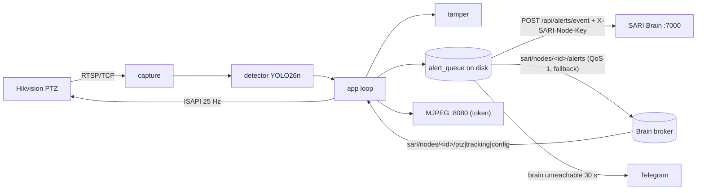

# SARI Eyes module (Jetson vision node)

Vision node of SARI (Sistema Autónomo de Respuesta a Intrusiones). It runs on an NVIDIA Jetson
Orin, detects people with YOLO26n (TensorRT FP16), keeps them centred with a Hikvision PTZ camera,
serves an authenticated MJPEG stream and reports intrusions and camera tampering to the
**SARI Brain** ([SARI_brain_agent_module](https://github.com/suriel01/SARI_brain_agent_module)).
The brain, not this node, decides whether the siren sounds.



## Layout

| Path | Purpose |
|------|---------|
| `camara_ptz.py` | Container entry point (`sari_eyes.app.main`) |
| `jetson_telemetry.py` | Host telemetry agent entry point (`sari_eyes.telemetry.main`) |
| `telegram_alert.py` | CLI to send a test Telegram message |
| `sari_eyes/config.py` | Environment loading; fails closed on missing variables |
| `sari_eyes/capture.py` | Threaded RTSP capture with reconnect watchdog |
| `sari_eyes/detector.py` | YOLO loading (TensorRT engine cache) and person detection |
| `sari_eyes/ptz.py` | Hikvision ISAPI control, tracking speeds, manual pulses |
| `sari_eyes/intrusion.py` | "person present ≥ 5 s" alert timing |
| `sari_eyes/tamper.py` | RTSP loss, black, occluded and frozen frame detection |
| `sari_eyes/alerts.py`, `alert_queue.py` | Alert payloads; persistent queue, retry/backoff, Telegram fallback |
| `sari_eyes/commands.py` | Validation of MQTT commands |
| `sari_eyes/stream.py` | Token-protected MJPEG/snapshot server |
| `sari_eyes/transport/` | REST (node key) and MQTT (per-node topics, TLS) transports |
| `deploy/` | systemd unit and env template for the telemetry agent |
| `spec/` | Functional specs (Spanish) |

## Configuration

Copy `.env.example` to `.env` (never committed) and fill every `<placeholder>`; the node refuses to
start when one is missing. Key rules:

- `MQTT_USER` must equal `JETSON_NODE_ID` (broker ACL `sari/nodes/%u/...`), e.g. `Jetson-PTZ_1`.
- `SARI_NODE_KEY` is this node's entry in the brain's `SARI_NODE_KEYS` (`node_id:key`).
- `CEREBRO_HTTP_EVENT_URL` points at the brain API, port 7000: `http://<brain>:7000/api/alerts/event`.
- `EYES_STREAM_TOKEN` (≥ 16 chars) protects `/mjpeg` and `/snapshot` (header `X-SARI-Stream-Token`
  or `?token=`). Register the brain's `stream_url` as `http://<jetson>:8080/mjpeg?token=<token>`.
- Optional `MQTT_TLS_CA=/path/ca.crt` enables TLS (default port 8883).
- Old names `MQTT_PASS`, `MQTT_PORT` and `CEREBRO_PORT_HTTP` are rejected with a rename hint.

## Run (Jetson)

```bash
sudo mkdir -p model_cache alert_queue && sudo chown -R 10001:10001 model_cache alert_queue
docker compose up --build -d
docker compose logs -f
docker compose down
```

The container runs as the unprivileged `sari` user (uid 10001) with all capabilities dropped. The
base image is pinned by tag and digest; bump it deliberately (a new TensorRT invalidates the cached
`model_cache/yolo26n.engine`).

Telemetry agent (host): install `deploy/sari-jetson.service`, create `/etc/sari/jetson.env` from
`deploy/jetson.env.example` (root:root, 0600) and `sudo systemctl enable --now sari-jetson`.

## Tests

```bash
python3 -m venv .venv && .venv/bin/pip install -r requirements-dev.txt
.venv/bin/pytest -q
```

Tests mock the camera, YOLO, the broker and HTTP; they do not need a Jetson.
